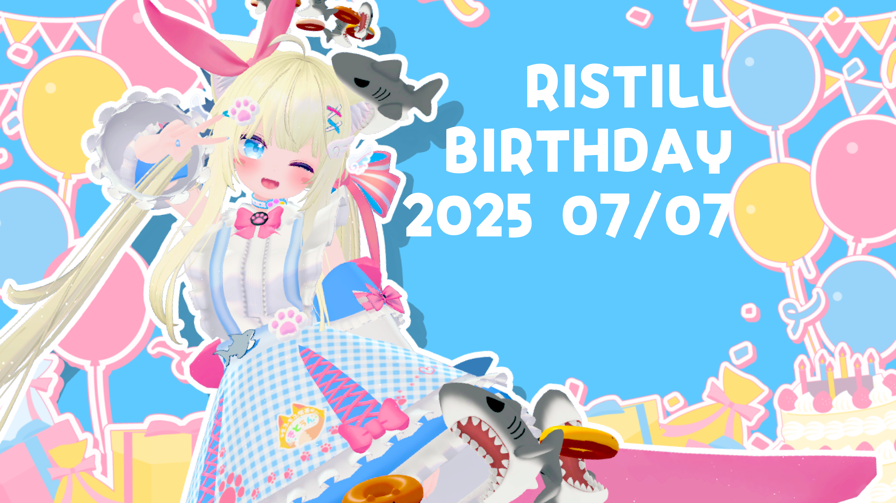

# Mosaic Art Generator

<div align="center">

[](https://github.com/naporin0624/mosaic-art-rust/actions/workflows/ci.yml)
[](https://naporin0624.github.io/mosaic-art-rust/badges/coverage.svg)
[](https://opensource.org/licenses/MIT)
[](https://www.rust-lang.org)
[](https://github.com/naporin0624/mosaic-art-rust/stargazers)
[](https://github.com/naporin0624/mosaic-art-rust/network)
[](https://github.com/naporin0624/mosaic-art-rust/issues)
[](https://github.com/naporin0624/mosaic-art-rust/commits/main)
[](https://www.rust-lang.org/)
[](https://github.com/naporin0624/mosaic-art-rust)
[](https://github.com/naporin0624/mosaic-art-rust)
[](https://github.com/naporin0624/mosaic-art-rust)

</div>

A high-performance mosaic art generator written in Rust that creates stunning mosaic images by intelligently replacing sections of a target image with smaller material images based on perceptual color similarity.

## Example Output

Transform any image into a detailed mosaic composed of thousands of smaller images:

<div align="center">

|                          Original Image                           |                       Generated Mosaic (24,000 tiles)                       |
| :---------------------------------------------------------------: | :-------------------------------------------------------------------------: |
|  |  |

</div>

## Features

### Dual Interface Support

- **🖥️ Graphical User Interface (GUI)**: Modern cross-platform desktop application with iced framework
- **⌨️ Command Line Interface (CLI)**: Full-featured terminal application for automation and scripting

### Core Algorithm Features

- **Perceptual Color Matching**: Uses Lab color space with k-d tree (O(log n) search) for perceptually accurate matching
- **Parallel Processing**: Automatic parallelization with Rayon for multi-core performance
- **Smart Placement Algorithm**: Multi-factor scoring system considering:
  - Color distance (primary factor)
  - Usage count limits to ensure variety
  - Adjacency penalties to prevent clustering of similar images
- **Color Adjustment**: Advanced HSV-based color adjustment to better match target regions
- **Similarity Database**: Pre-computed similarity matrix with JSON persistence for faster subsequent runs
- **Post-placement Optimization**: Simulated annealing algorithm for iterative improvement

### User Experience Features

- **Real-time Visualization**: ASCII grid display and progress tracking with ETA
- **Cross-Platform Support**: Works on Windows, macOS, and Linux
- **Native File Dialogs**: Integrated file picker with format filtering
- **Theme Support**: Light and dark themes for comfortable usage
- **Auto Grid Calculation**: Intelligent grid dimension calculation from tile count
- **Aspect Ratio Matching**: Intelligent filtering with fallback strategies
- **SIMD Optimization**: Hardware-accelerated image resizing via fast_image_resize

## Installation

### Prerequisites

- Rust 1.88.0 or later
- Cargo 0.89.0 or later

### Using mise (Recommended)

```bash
# Clone the repository
git clone https://github.com/naporin0624/mosaic-art-rust
cd mosaic-rust

# Set up development environment
mise install
mise trust

# Build optimized release version
cargo build --release
```

### Manual Installation

```bash
# Install Rust via rustup
curl --proto '=https' --tlsv1.2 -sSf https://sh.rustup.rs | sh

# Build the project
cargo build --release
```

### Building Individual Components

You can build just the GUI or CLI independently:

```bash
# Build only the CLI application (default — for servers/automation)
cargo build --release --bin mosaic-rust

# Build the GUI application (requires the `gui` feature)
cargo build --release --bin mosaic-gui --features gui

# Build everything including the GUI
cargo build --release --features gui
```

The GUI is gated behind the opt-in `gui` cargo feature. A default build compiles only the CLI and needs **no GTK/X11 development libraries**, so it works out of the box in Docker images and on headless servers.

You can also install the CLI directly from git without cloning:

```bash
cargo install --git https://github.com/naporin0624/mosaic-art-rust --bin mosaic-rust
```

**Benefits of independent building:**

- **Faster compilation**: Only builds what you need
- **Smaller binary size**: No unused dependencies
- **No GUI system dependencies**: CLI-only builds skip GTK/X11 entirely
- **Deployment flexibility**: Ship GUI-only or CLI-only applications

## Quick Start

### Command Line Interface (CLI)

```bash
# Basic usage with default settings
./target/release/mosaic-rust \
  --target photo.jpg \
  --material-src ./materials \
  --output mosaic.jpg

# Recommended settings for high quality
./target/release/mosaic-rust \
  --target photo.jpg \
  --material-src ./materials \
  --output mosaic.jpg \
  --grid-w 80 \
  --grid-h 60 \
  --max-materials 1500 \
  --adjacency-penalty-weight 0.25 \
  --color-adjustment-strength 0.4 \
  --optimization-iterations 2000
```

### Using as a Library (Rust API)

The full generation pipeline is also exposed as a library, so other Rust programs (servers, batch jobs, containers) can drive it without shelling out to the CLI:

```toml
# Cargo.toml
[dependencies]
mosaic-rust = { git = "https://github.com/naporin0624/mosaic-art-rust" }
```

```rust
use mosaic_rust::pipeline::{run_pipeline, PipelineConfig};

let config = PipelineConfig {
    target: "photo.jpg".into(),
    material_src: "./materials".into(),
    output: "mosaic.jpg".into(),
    ..Default::default() // defaults mirror the CLI flags
};
let report = run_pipeline(&config)?;
println!("placed {} tiles", report.total_tiles);
```

For resident processes that generate many mosaics, `MaterialLibrary` loads and decodes the material directory once and can be reused across runs:

```rust
use mosaic_rust::pipeline::{run_pipeline_with, MaterialLibrary, PipelineConfig};

let library = MaterialLibrary::load("./materials".as_ref(), 500, None)?;
let report = run_pipeline_with(&library, &config)?;
// library.add_incremental(...) picks up newly added files without re-decoding
```

Progress reporting is available via `run_pipeline_with_progress`, which takes a callback receiving `ProgressEvent`s (the CLI's progress bars are built on the same API). The library pulls in no GUI or terminal-UI dependencies.

### Graphical User Interface (GUI)

For an intuitive visual interface, use the GUI application:

```bash
# Launch the GUI application
./target/release/mosaic-gui

# Or run from source
cargo run --bin mosaic-gui --release --features gui

# Build and run GUI only
cargo build --release --bin mosaic-gui --features gui && ./target/release/mosaic-gui
```

> **Note**: The GUI requires the `gui` cargo feature (and GTK development libraries on Linux). See [Building Individual Components](#building-individual-components).

> **💡 Independent Application**: The GUI is completely independent from the CLI and can be built and deployed separately. It includes all mosaic generation functionality built-in.

#### GUI Features

The GUI provides a user-friendly interface with all CLI functionality:

- **🎯 File Selection**: Easy browse buttons for target image, material directory, and output path
- **⚙️ Grid Settings**: Visual controls for grid dimensions with auto-calculation
- **🔧 Advanced Settings**: Full access to all optimization parameters
- **🎨 Theme Support**: Light/dark theme toggle for comfortable usage
- **📱 Cross-Platform**: Works on Windows, macOS, and Linux
- **🖥️ No Terminal**: Clean desktop application (no terminal window on Windows)

#### GUI Usage Guide

1. **File Selection**:

   - **Target Image**: Click "Browse" to select your source image (PNG, JPG, JPEG)
   - **Material Directory**: Choose the folder containing your material images
   - **Output Path**: Specify where to save the generated mosaic

2. **Grid Configuration**:

   - **Auto-Calculate**: Enable to automatically calculate optimal grid dimensions
   - **Total Tiles**: Enter desired number of tiles (e.g., 1400 for 50×28 grid)
   - **Manual Grid**: Directly set width and height dimensions

3. **Advanced Settings**:

   - **Max Materials**: Limit number of material images to use (affects memory usage)
   - **Color Adjustment**: Fine-tune color matching strength (0.0-1.0)
   - **Enable Optimization**: Toggle post-placement optimization for better results

4. **Generation**:
   - Click **"Generate Mosaic"** to start processing
   - Use **"Toggle Theme"** to switch between light and dark modes

#### Auto Grid Calculation

The GUI includes an intelligent grid calculation feature:

```
For a target total of N tiles with 16:9 aspect ratio:
- Width = √(N × 16/9) rounded to nearest integer
- Height = N ÷ Width (minimum 1)
```

Example: 1400 tiles → 50×28 grid (actual: 1400 tiles)

## Example: High-Resolution Birthday Mosaic

This example demonstrates the generator's capabilities using a birthday artwork as the target image, showcasing the detailed color matching and optimization features.

|                  Original Image                   |         Generated Mosaic (24,000 tiles)          |
| :-----------------------------------------------: | :----------------------------------------------: |
|  |  |

### Command Used

```bash
./target/release/mosaic-rust \
  --target ./mosaic.png \
  --material-src ./sozai \
  --output mosaic_24000_4.png \
  --grid-w 206 \
  --grid-h 116 \
  --max-materials 2849 \
  --max-usage-per-image 9 \
  --adjacency-penalty-weight 0.25 \
  --optimization-iterations 2000 \
  --color-adjustment-strength 0.4
```

This high-resolution mosaic was created for the [Ristill Birthday 2025](https://ristill.club/2025) website, demonstrating the generator's ability to handle complex artwork with vibrant colors and intricate details. The 206×116 grid creates a mosaic with 23,896 individual tiles, each carefully selected from a collection of 2,849 material images.

## Documentation

### Comprehensive Documentation

For detailed information about using the mosaic generator:

- **[API Documentation](docs/api/)** - Detailed API reference covering all modules and functions
  - [Core API Reference](docs/api/core.md) - Core traits, structs, and functions
  - [Module API Reference](docs/api/modules.md) - Complete module-specific documentation
- **[CLI Documentation](docs/cli/)** - Complete command-line interface guide
  - [CLI Reference](docs/cli/reference.md) - Comprehensive parameter documentation
  - [CLI Examples & Tutorials](docs/cli/examples.md) - Practical usage examples and tutorials

### Quick Reference: Command Line Options

For a quick overview of the main options:

### Required Arguments

| Option           | Short | Description                          |
| ---------------- | ----- | ------------------------------------ |
| `--target`       | `-t`  | Path to the target image             |
| `--material-src` | `-m`  | Directory containing material images |
| `--output`       | `-o`  | Output mosaic image path             |

### Key Configuration Options

| Option                        | Description                             | Default |
| ----------------------------- | --------------------------------------- | ------- |
| `--grid-w`                    | Number of tiles horizontally            | 50      |
| `--grid-h`                    | Number of tiles vertically              | 28      |
| `--max-materials`             | Maximum number of materials to load     | 500     |
| `--max-usage-per-image`       | Maximum times each material can be used | 3       |
| `--adjacency-penalty-weight`  | Weight for adjacency penalty (0.0-1.0)  | 0.3     |
| `--optimization-iterations`   | Maximum optimization iterations         | 1000    |
| `--color-adjustment-strength` | Color adjustment strength (0.0-1.0)     | 0.3     |

📚 **For complete parameter documentation, examples, and tutorials, see [CLI Documentation](docs/cli/)**

## Advanced Examples

### Ultra High Quality (Slow)

```bash
./target/release/mosaic-rust \
  --target photo.jpg \
  --material-src ./materials \
  --output ultra_quality.jpg \
  --grid-w 150 \
  --grid-h 100 \
  --max-materials 5000 \
  --max-usage-per-image 2 \
  --adjacency-penalty-weight 0.4 \
  --optimization-iterations 10000 \
  --color-adjustment-strength 0.5
```

### Fast Preview Mode

```bash
./target/release/mosaic-rust \
  --target photo.jpg \
  --material-src ./materials \
  --output preview.jpg \
  --grid-w 30 \
  --grid-h 20 \
  --enable-optimization false \
  --adjacency-penalty-weight 0.0 \
  --color-adjustment-strength 0.0 \
  --show-grid false \
  --show-time false
```

### Portrait Orientation (9:16)

```bash
./target/release/mosaic-rust \
  --target portrait.jpg \
  --material-src ./materials \
  --output portrait_mosaic.jpg \
  --grid-w 56 \
  --grid-h 100 \
  --aspect-tolerance 0.05 \
  --max-usage-per-image 2
```

### Unique Tiles Only

```bash
./target/release/mosaic-rust \
  --target photo.jpg \
  --material-src ./materials \
  --output unique_tiles.jpg \
  --max-usage-per-image 1 \
  --max-materials 3000
```

## Architecture & Algorithms

### Color Space & Matching

The generator uses the **Lab color space** for perceptually uniform color matching:

- L\*: Lightness (0-100)
- a\*: Green-red color component
- b\*: Blue-yellow color component

A **k-d tree** with bucket size 256 provides O(log n) nearest neighbor search performance.

### Material Selection Algorithm

Each grid cell's material is selected using a multi-factor scoring system:

```
score = color_distance * (1 + usage_penalty) * (1 + adjacency_penalty)
```

Where:

- `color_distance`: Euclidean distance in Lab space
- `usage_penalty`: Increases with each use of the material
- `adjacency_penalty`: Based on similarity to adjacent tiles

### Optimization Phase

The simulated annealing algorithm:

1. Initial temperature: 1.0
2. Cooling rate: 0.95 per iteration
3. Acceptance probability: `exp(-delta / temperature)`
4. Swaps tiles to minimize total adjacency penalty

### Performance Optimizations

- **Parallel Loading**: Rayon parallelizes material image loading
- **SIMD Resizing**: fast_image_resize uses CPU vector instructions
- **Memory Efficiency**: Arc<Tile> for shared immutable data
- **Similarity Caching**: Pre-computed similarity matrix (O(n²) → O(1))

## Processing Pipeline

1. **Initialization**

   - Load materials with parallel processing
   - Filter by aspect ratio (with fallback)
   - Build/load similarity database

2. **Indexing**

   - Calculate Lab colors for all materials
   - Build k-d tree for fast searching

3. **Grid Generation**

   - Divide target into grid cells
   - Calculate average Lab color per cell

4. **Material Placement**

   - Find best material for each cell
   - Consider all constraints (usage, adjacency)
   - Apply color adjustment if enabled

5. **Optimization** (if enabled)

   - Run simulated annealing
   - Swap tiles to improve placement

6. **Assembly**
   - Resize materials to cell size
   - Compose final mosaic image

## Performance Tips

### For Fastest Processing

- Use `--enable-optimization false`
- Set `--adjacency-penalty-weight 0.0`
- Disable visualization with `--show-grid false`
- Limit materials with `--max-materials 200`

### For Best Quality

- Increase grid resolution (e.g., 100x75 or higher)
- Use more materials (`--max-materials 2000+`)
- Enable color adjustment (`--color-adjustment-strength 0.4-0.6`)
- Increase optimization iterations (`--optimization-iterations 5000+`)

### For Memory Efficiency

- Limit materials if RAM is constrained
- Use smaller grid sizes
- Disable similarity database with `--rebuild-similarity-db`

## Troubleshooting

### "Warning: No materials match the target aspect ratio"

```bash
# Solution 1: Increase tolerance
--aspect-tolerance 0.2  # Allow ±20% difference

# Solution 2: Check your materials
# Ensure material directory has images with similar aspect ratios
```

### Out of Memory Errors

```bash
# Reduce memory usage
--max-materials 100
--grid-w 40
--grid-h 30
```

### Slow Performance

```bash
# Quick mode settings
--enable-optimization false
--show-grid false
--adjacency-penalty-weight 0.0
--color-adjustment-strength 0.0
```

## Build from Source

### Development Build

### Quick Start with Build Scripts

Choose the appropriate build script for your platform:

**Windows (PowerShell - Recommended)**

```powershell
# Full build with all features
.\build.ps1

# Build specific targets
.\build.ps1 -Target cli -Config release
.\build.ps1 -Target gui -Config debug -Test

# Development workflow
.\dev.ps1 run-cli      # Quick CLI test
.\dev.ps1 run-gui      # Launch GUI
.\dev.ps1 example      # Generate showcase
```

**Windows (Command Prompt)**

```cmd
# Release build (recommended)
build.bat

# Debug build
build.bat debug

# Clean artifacts
build.bat clean
```

**Linux/macOS/WSL**

```bash
# Full release build
./quick-build.sh build

# Development commands
./quick-build.sh test          # Run tests
./quick-build.sh example       # Generate example
./quick-build.sh format        # Format code
```

### Manual Build Commands

```bash
# Build CLI application
cargo build

# Build GUI application
cargo build --bin mosaic-gui --features gui

# Run all tests (111 total)
cargo test

# Code quality checks
cargo clippy  # Lint code
cargo fmt  # Format code
```

### Release Build with Optimizations

```bash
# Build optimized CLI application
cargo build --release

# Build optimized GUI application
cargo build --bin mosaic-gui --release --features gui
```

### Build Scripts Features

- 🚀 **Cross-platform support** (Windows, Linux, macOS)
- 🔧 **Multiple build configurations** (debug/release)
- 🧪 **Integrated testing** with verbose output
- 📦 **Binary installation** to local bin directory
- 🎨 **Code formatting** and linting (rustfmt, clippy)
- 📊 **Build summaries** with file sizes and usage examples
- 🌈 **Colored output** for better developer experience

See [BUILD_GUIDE.md](BUILD_GUIDE.md) for detailed build instructions and troubleshooting.

The release profile includes:

- Link Time Optimization (LTO)
- Maximum optimization level (3)
- Single codegen unit for better optimization
- Windows subsystem configuration (no terminal for GUI)

## Project Structure

```
mosaic-rust/
├── src/
│   ├── main.rs              # CLI application entry point
│   ├── lib.rs               # Core traits, types, and tests
│   ├── similarity.rs        # Similarity database with JSON persistence
│   ├── adjacency.rs         # Adjacency constraints and penalty calculation
│   ├── optimizer.rs         # Simulated annealing optimization
│   ├── color_adjustment.rs  # HSV color adjustment algorithms
│   ├── grid_visualizer.rs   # ASCII progress display
│   ├── time_tracker.rs      # Performance tracking and ETA
│   └── gui/                 # GUI application
│       ├── main.rs          # GUI application entry point
│       └── app_full.rs      # Complete GUI implementation
├── build.ps1               # PowerShell build script (Windows)
├── build.bat               # Batch build script (Windows CMD)
├── quick-build.sh          # Shell build script (Linux/macOS/WSL)
├── dev.ps1                 # Development helper script
├── BUILD_GUIDE.md          # Comprehensive build instructions
├── docs/                    # Comprehensive documentation
│   ├── README.md            # Documentation overview
│   ├── api/                 # API documentation
│   │   ├── core.md          # Core API reference
│   │   └── modules.md       # Module-specific documentation
│   ├── cli/                 # CLI documentation
│   │   ├── reference.md     # Complete CLI parameter guide
│   │   └── examples.md      # Usage examples and tutorials
│   └── gui/                 # GUI documentation
│       ├── README.md        # GUI overview and usage
│       ├── architecture.md  # GUI architecture and design
│       └── examples.md      # GUI usage examples
├── .claude/                 # AI assistant configuration
│   └── commands/
│       ├── mosaic.md        # Custom mosaic command generator
│       ├── commit-changes.md # Git commit helper
│       └── release.md       # Release management
├── .github/workflows/       # CI/CD pipeline
│   └── ci.yml               # GitHub Actions workflow
├── Cargo.toml               # Dependencies and build configuration
├── CLAUDE.md                # AI assistant documentation
├── README.md                # Project overview and usage
└── LICENSE                  # MIT license
```

## Dependencies

### Core Dependencies

- **image** (0.25): Core image I/O functionality
- **fast_image_resize** (5.0): SIMD-optimized resizing with Rayon support
- **palette** (0.7): Lab color space conversions
- **kiddo** (5.0): High-performance k-d tree
- **rayon** (1.10): Data parallelism
- **anyhow** (1.0): Error handling
- **serde/serde_json** (1.0): JSON serialization
- **rand** (0.8): Random number generation

### CLI Dependencies

- **clap** (4.0): CLI argument parsing with derive macros
- **indicatif** (0.17): Progress bars and ETA display

### GUI Dependencies

- **iced** (0.12): Modern cross-platform GUI framework
- **rfd** (0.14): Native file dialogs (open/save)
- **tokio** (1.0): Async runtime for file operations

## Badge Setup

The project includes automated badge generation for build status and code coverage:

### Code Coverage Badge Setup

1. **Enable GitHub Pages**: Go to Settings → Pages → Source: **GitHub Actions** → Save
2. **Badge URLs**: The badges are already configured for `naporin0624/mosaic-art-rust`
3. **First Run**: Push changes to trigger the coverage workflow, which will automatically deploy the badge

The coverage badge will be available at: `https://naporin0624.github.io/mosaic-art-rust/badges/coverage.svg`

### Available Badges

- **CI Status**: Automated build and test status from GitHub Actions
- **Code Coverage**: Generated by cargo-tarpaulin and hosted on GitHub Pages
- **License**: MIT License badge
- **Rust Version**: Minimum supported Rust version (1.88.0+)
- **GitHub Stats**: Stars, forks, issues, and last commit information
- **Made with Rust**: Language identifier badge
- **Platform Support**: Cross-platform compatibility (Linux, macOS, Windows)
- **Code Size**: Size of the codebase in bytes
- **Repo Size**: Total repository size

## Contributing

Contributions are welcome! Please ensure:

- Code passes `cargo test`
- Code is formatted with `cargo fmt`
- No warnings from `cargo clippy`
- New features include tests

## License

This project is licensed under the MIT License - see below for details:

```
MIT License

Copyright (c) 2024 mosaic-rust contributors

Permission is hereby granted, free of charge, to any person obtaining a copy
of this software and associated documentation files (the "Software"), to deal
in the Software without restriction, including without limitation the rights
to use, copy, modify, merge, publish, distribute, sublicense, and/or sell
copies of the Software, and to permit persons to whom the Software is
furnished to do so, subject to the following conditions:

The above copyright notice and this permission notice shall be included in all
copies or substantial portions of the Software.

THE SOFTWARE IS PROVIDED "AS IS", WITHOUT WARRANTY OF ANY KIND, EXPRESS OR
IMPLIED, INCLUDING BUT NOT LIMITED TO THE WARRANTIES OF MERCHANTABILITY,
FITNESS FOR A PARTICULAR PURPOSE AND NONINFRINGEMENT. IN NO EVENT SHALL THE
AUTHORS OR COPYRIGHT HOLDERS BE LIABLE FOR ANY CLAIM, DAMAGES OR OTHER
LIABILITY, WHETHER IN AN ACTION OF CONTRACT, TORT OR OTHERWISE, ARISING FROM,
OUT OF OR IN CONNECTION WITH THE SOFTWARE OR THE USE OR OTHER DEALINGS IN THE
SOFTWARE.
```

## Acknowledgments

Special thanks to the Rust community and the authors of the dependencies that make this high-performance implementation possible.
